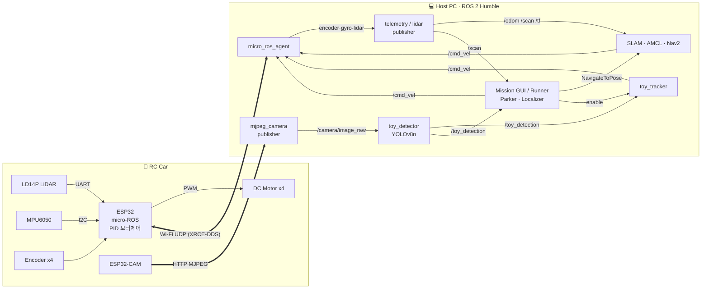

# 🚗 ROS2 ESP32 RC Car: 자율주행 · 라이다 주차 · YOLO 객체 추종

> **ESP32 + micro-ROS + ROS 2 Nav2 + YOLOv8** 로 만든 저가형 4륜 자율주행 RC카
> SLAM으로 만든 지도 위에서 **목적지 자율주행 → LiDAR 기반 정밀 주차 → 장난감 탐색·추종**을 하나의 미션으로 수행합니다.

<p align="center">
  
</p>


---

## 🎬 데모 영상

| 전체 미션 주행 | 미션 GUI |
|:---:|:---:|
| [](https://www.youtube.com/watch?v=IZZE8gLEQWk) | [](https://www.youtube.com/watch?v=iUp5C_9a7NM) |
| 위치 추정 → Nav2 자율주행 → 라이다 주차 → 장난감 탐색·추종 → 복귀 주차 | 지도 위 미션 편집·실행, 실시간 LiDAR·경로·YOLO 검출 화면 |

---

## 📌 목차
1. [데모 영상](#-데모-영상)
2. [프로젝트 개요](#-프로젝트-개요)
3. [시스템 아키텍처](#-시스템-아키텍처)
4. [하드웨어 구성](#-하드웨어-구성)
5. [핵심 기능](#-핵심-기능)
6. [디렉터리 구조](#-디렉터리-구조)
7. [실행 방법](#-실행-방법)
8. [배운 점 / 향후 계획](#-배운-점--향후-계획)

---

## 🧭 프로젝트 개요

| 항목 | 내용 |
|---|---|
| **목표** | 고가의 SBC(Jetson, RPi) 없이 **ESP32(WeMos D1 R32)만 탑재한 RC카**로 ROS 2 Nav2 자율주행 구현 |
| **핵심 아이디어** | 차량은 센서 수집과 모터 제어만 담당하고, SLAM·Nav2·YOLO 같은 무거운 연산은 **Wi-Fi로 연결된 PC**에서 처리 |
| **주요 기능** | ① SLAM 지도 작성 ② AMCL 위치 추정 + Nav2 자율주행 ③ LiDAR 벽 검출 기반 정밀 주차 ④ YOLOv8 장난감 인식 + 시각 서보 추종 ⑤ PyQt5 미션 GUI |
| **개발 환경** | Ubuntu 22.04, ROS 2 Humble, Arduino IDE (ESP32), Python 3.10, Ultralytics YOLOv8 |
| **사용 기술** | `ROS 2` `micro-ROS` `Nav2` `slam_toolbox` `AMCL` `YOLOv8` `OpenCV` `PyQt5` `ESP32` `ESP32-CAM` `C++` `Python` |

### 미션 시나리오 (`maps/map4_mission.json`)
```
[1] localize      제자리 회전으로 지도 위 내 위치 찾기 (AMCL 전역 위치 추정)
[2] nav           주차장 앞으로 자율주행 (Nav2)
[3] park          LiDAR로 뒤쪽 벽을 찾아 후진 정밀 주차
[4] nav           장난감 탐색 지점으로 이동
[5] search_toy    30°씩 회전하며 YOLO로 장난감 탐색
[6] follow        장난감을 30cm 거리로 따라가 목표 영역까지 유도
[7] nav → park    주차 구역으로 복귀해서 다시 주차
```

---

## 🏗 시스템 아키텍처

> 상세 설계 문서: **[docs/ARCHITECTURE.md](docs/ARCHITECTURE.md)** (토픽 표, TF 트리, 펌웨어 루프, 미션 시퀀스, 런치 구조)



| 계층 | 구성 |
|---|---|
| **Firmware** | ESP32: 4륜 PID 속도 제어, 엔코더·IMU·배터리 수집, LiDAR 파싱, micro-ROS / ESP32-CAM: MJPEG 스트리밍 |
| **Bridge / Driver** | `micro_ros_agent`, `robot_telemetry_publisher`(오도메트리), `lidar_publisher`(LaserScan), `mjpeg_camera_publisher` |
| **Navigation** | `slam_toolbox`(지도 작성), `AMCL`, `Nav2`(NavFn + RotationShim/DWB) |
| **Perception** | `toy_detector`(YOLOv8n), `toy_tracker`(시각 서보) |
| **Application** | `mission_gui`(PyQt5), `MissionRunner`, `Parker`, `Localizer` |

---

## 🔧 하드웨어 구성

```
[PC / 노트북 (Ubuntu 22.04, ROS 2 Humble)]
   ├─ micro_ros_agent (UDP 8888)
   ├─ slam_toolbox, Nav2, AMCL, rviz2
   └─ (라이다 원시 데이터를 받아 LaserScan으로 재조립)
        ▲  Wi-Fi (UDP, micro-ROS)
        ▼
[WeMos D1 R32 (ESP32-WROOM-32)]
   ├─ 모터드라이버 → DC 기어모터 4개 (엔코더 포함)
   ├─ MPU6050 IMU (I2C)
   ├─ LD14P 라이다 (UART)
   └─ 배터리 전압 측정 (ADC)

[ESP32-CAM (OV3660)]
   └─ MJPEG HTTP 스트리밍 → PC (mjpeg_camera_publisher)
```

| 부품 | 모델 / 사양 | 용도 |
|---|---|---|
| MCU | WeMos D1 R32 (ESP32-WROOM-32) | 모터 제어, 센서 수집, micro-ROS 클라이언트 |
| 구동부 | 모터드라이버 + 엔코더 DC 기어모터 ×4 | 스키드 스티어 4륜 구동, 바퀴별 PID 속도 제어 |
| IMU | MPU6050 (I2C) | 자이로 Z축으로 Yaw 추정 |
| LiDAR | LDROBOT LD14P (UART) | 360°, 6Hz, 0.15~8m |
| 전원 감시 | 배터리 전압 측정 (ADC) | `/battery_voltage` 발행 |
| Camera | ESP32-CAM (OV3660) | 장난감 인식용 MJPEG 스트리밍 |
| Host | PC / 노트북 (Ubuntu 22.04, ROS 2 Humble) | micro-ROS Agent, SLAM, Nav2, YOLO, GUI |

---

## ✨ 핵심 기능

### 1. micro-ROS 기반 ESP32 펌웨어 (`esp32/`)
- 메인 루프 하나에서 **LiDAR 수신, 100Hz 모터 제어, micro-ROS 통신**을 순서대로 돌리는 협조형 스케줄링
- 바퀴 4개를 각각 **PID로 RPM 피드백 제어**하고, 가감속 램프로 급가속에 의한 슬립을 줄임
- `/cmd_vel (v, ω)` → 차동 구동 기구학 → 좌/우 목표 RPM
- 엔코더 변화량, 자이로 Z, 배터리 전압, Wi-Fi RSSI를 **NTP 타임스탬프와 함께** `Int64MultiArray` 하나로 발행
- Wi-Fi가 끊기거나 Agent가 응답하지 않으면 **스스로 재부팅해 다시 연결**

### 2. SLAM & Nav2 자율주행
- `slam_toolbox`(online async)로 지도를 만들고 `map_saver`로 저장
- **엔코더(거리) + 자이로(회전) 퓨전 오도메트리**: 스키드 스티어는 바퀴가 미끄러져 엔코더만으로는 회전 오차가 커서, Yaw는 자이로로 계산
- AMCL(Differential, 파티클 최대 2000) + Nav2 NavFn 플래너 + **RotationShim + DWB** 컨트롤러
  - 제자리 회전이 가능한 스키드 스티어 특성에 맞춰, 경로 방향으로 먼저 회전한 뒤 주행
- **전역 위치 추정(Localizer)**: `reinitialize_global_localization`으로 파티클을 지도 전체에 뿌린 뒤 45°씩 회전하며 AMCL 공분산(σxy < 0.15m, σyaw < 10°)과 **LiDAR-지도 일치율(≥ 60%)** 로 수렴 여부를 판단

### 3. LiDAR 기반 정밀 주차 (`parking.py`)
Nav2만으로는 벽에 cm 단위로 붙여 주차하기 어려워서, **LiDAR 점군을 직접 처리하는 별도 주차 컨트롤러**를 만들었습니다.

```
① 벽 측정  : /scan 5프레임 누적 → 1.5m 이내 점 → RANSAC 직선 검출(200회, inlier 3cm)
              → 구간 분할(간격 15cm 이상이면 분리) → 동일 직선 병합
              → 로봇 진행 방향과 수직(±35°)이고 사용자가 그린 주차선과 일치하는 벽 선택
② Pre-park : 벽 중심 법선 방향으로 (standoff + 0.35m) 떨어진 자세까지 cmd_vel로 이동
③ 재측정   : 가까이서 벽을 다시 측정해 정확도 향상
④ 최종 접근: 목표를 odom 좌표계에 고정 (AMCL 보정으로 map 좌표가 튀어도 흔들리지 않게)
              → 실시간 벽 재피팅으로 거리·각도 피드백 → 후진 주차
              → 진행 방향 안전 거리(3cm) 감시
```
- 결과(벽 거리, 각도 오차, 벽 중심 대비 오프셋)를 미션 파일에 저장하고 GUI에 표시

### 4. YOLOv8 장난감 인식 & 추종 (`yolo/`, `toy_detector.py`, `toy_tracker.py`)
**데이터 수집부터 학습, 배포까지 전 과정을 직접 구축**했습니다.

| 단계 | 도구 | 내용 |
|---|---|---|
| 수집 | `capture_images.py` | 로봇에 장착된 ESP32-CAM 영상 그대로 수집 (실제 높이, 각도, 해상도) |
| 라벨링 | `label_tool.py` | 직접 만든 OpenCV 라벨링 툴 (드래그 박스, 빈 배경 `e`, 제외 `x`, 이어하기) |
| 분할 | `split_dataset.py` | train 80% / val 20% 자동 분할, `data.yaml` 생성 |
| 학습 | `train.py` | YOLOv8n, imgsz 320, 100 epoch, CPU, early stopping |

**시각 서보 추종 (`toy_tracker`)**: 카메라 하나만으로 방향과 거리를 추정합니다.
- 방향: `cx − cx_offset` (카메라 장착 오차를 캘리브레이션으로 보정)
- 거리: `ref_dist × ref_h / h` (기준 거리에서 잰 박스 높이로 핀홀 모델 역산) → 30cm 유지
- 놓쳤을 때: 화면 가장자리로 빠져나간 방향 / 움직이던 방향으로 **가속 회전 탐색**
- 히스테리시스: 처음 잡을 때는 `conf ≥ 0.7`, 추적 중에는 `conf ≥ 0.5`면 유지
- 미션이 `/toy_tracker/enable`로 켜고 끄며, 꺼지면 정지 명령을 한 번 보내고 `/cmd_vel`을 Nav2에 넘겨서 **충돌하지 않음**

### 5. 미션 GUI (`mission_gui.py`, PyQt5)
- 지도 위에서 **장소, 주차 구역, 주차선을 마우스로 지정**하고 미션 단계를 추가, 편집, 순서 변경
- 실시간 표시: 로봇 자세, LiDAR 점, Nav2 경로, 이동 궤적, 검출된 벽, 주차 목표, YOLO 검출 영상, 배터리
- 단계 하나만 실행하거나 특정 단계부터 실행, 취소 가능 (미션은 별도 스레드, ROS는 `MultiThreadedExecutor`)

---

## 📁 디렉터리 구조

```
ros2-esp32-rccar/
├── docs/
│   └── ARCHITECTURE.md              # 상세 아키텍처 문서
├── esp32/                           # ESP32 펌웨어 (Arduino 스케치 2개)
│   ├── ros2_rc_car/                 # WeMos D1 R32 (ESP32-WROOM-32)
│   │   ├── ros2_rc_car.ino          #   메인: LiDAR 수신 / 모터 제어 / micro-ROS 루프
│   │   ├── RobotController.*        #   (v, ω) → 4륜 RPM, PID, 배터리
│   │   ├── DCMotorSpeed.* DCMotorPWM.*  # 바퀴별 속도 제어 / PWM 출력
│   │   ├── PIDController.* Encoder.*    # PID, 쿼드러처 엔코더
│   │   ├── myMPU6050.*              #   IMU 자이로
│   │   ├── analysis_one.* lidar_frame.h # LD14P 프레임 파서
│   │   ├── lidar_publish.*          #   LiDAR 세그먼트 발행
│   │   └── rosCmdVel.* rosEncoderDeltasGyroZ.*  # micro-ROS 구독/발행
│   └── camera/                      # ESP32-CAM
│       └── camera.ino               #   MJPEG HTTP 스트리밍 서버
├── ros2/pros2_robot/                # ROS 2 패키지 (ament_python)
│   ├── pros2_robot/
│   │   ├── robot_telemetry_publisher.py  # 엔코더+자이로 → /odom, TF, /joint_states
│   │   ├── lidar_publisher.py            # 세그먼트 → /scan
│   │   ├── mjpeg_camera_publisher.py     # MJPEG → /camera/image_raw
│   │   ├── toy_detector.py               # YOLOv8 검출 → /toy_detection
│   │   ├── toy_tracker.py                # 시각 서보 추종
│   │   ├── robot_interface.py            # 공용 노드 (TF, Nav2 Action, cmd_vel)
│   │   ├── localization.py               # AMCL 전역 위치 추정
│   │   ├── parking.py                    # LiDAR 벽 검출 주차
│   │   ├── mission_runner.py             # 미션 실행기
│   │   ├── mission_gui.py                # PyQt5 GUI
│   │   ├── map_utils.py                  # 지도 / 좌표 변환 / 미션 파일 유틸
│   │   └── teleop_twist_keyboard.py
│   ├── launch/      # robot_bringup, rsp, slam, navigation, mission
│   ├── config/      # nav2_params.yaml, slam_params.yaml, nav2.rviz
│   ├── description/ # robot.urdf.xacro
│   ├── maps/        # map4.pgm/yaml, map4_mission.json
│   └── yolo/        # 데이터 수집 / 라벨링 / 학습 파이프라인, models/toy_best.pt
├── LICENSE
└── .gitignore
```

---

## 🚀 실행 방법

### 0. 요구 사항
- Ubuntu 22.04 + ROS 2 Humble
- `nav2_bringup`, `slam_toolbox`, `robot_state_publisher`, `xacro`, `cv_bridge`, `tf_transformations`
- [micro-ROS Agent](https://github.com/micro-ROS/micro_ros_setup) 빌드
- ESP32: Arduino IDE + [micro_ros_arduino](https://github.com/micro-ROS/micro_ros_arduino) (Humble)

### 1. 펌웨어 업로드
1. 각 스케치 폴더(`esp32/ros2_rc_car/`, `esp32/camera/`)에 `secrets.h`를 만들고 Wi-Fi 정보를 입력 (`secrets.h`는 git에 올라가지 않음)
   ```cpp
   // secrets.h
   #define WIFI_SSID     "YOUR_WIFI_SSID"
   #define WIFI_PASSWORD "YOUR_WIFI_PASSWORD"
   #define AGENT_IP      "192.168.137.1"   // micro-ROS Agent PC IP (ros2_rc_car만 사용)
   #define AGENT_PORT    8888
   ```
2. Arduino IDE에서 `esp32/ros2_rc_car/ros2_rc_car.ino`는 WeMos D1 R32에, `esp32/camera/camera.ino`는 ESP32-CAM에 업로드

### 2. 빌드
```bash
mkdir -p ~/pros2_ws/src && cd ~/pros2_ws/src
git clone https://github.com/UniverseSM/ros2-esp32-rccar.git
ln -s ros2-esp32-rccar/ros2/pros2_robot .
cd ~/pros2_ws && rosdep install --from-paths src -y --ignore-src
colcon build --packages-select pros2_robot && source install/setup.bash

# YOLO 환경 (venv, 한 번만)
cd src/pros2_robot/yolo && bash setup.sh
```

### 3. 실행
```bash
# (A) 지도 만들기
ros2 launch pros2_robot robot_bringup.launch.py
ros2 launch pros2_robot slam.launch.py rviz:=true
ros2 run pros2_robot teleop_twist_keyboard
ros2 run nav2_map_server map_saver_cli -f ~/pros2_ws/src/pros2_robot/maps/<name>

# (B) 전체 미션 (bringup + Nav2 + 카메라 + YOLO + GUI)
ros2 launch pros2_robot mission.launch.py
ros2 launch pros2_robot mission.launch.py map:=<map.yaml> rviz:=true stream_url:=http://<cam-ip>/stream

# (C) GUI 없이 미션 실행
ros2 run pros2_robot mission --ros-args -p map_yaml:=<map.yaml> -p start:=1

# (D) 장난감 추종만 따로 실행
ros2 run pros2_robot toy_detector
ros2 run pros2_robot toy_tracker --calibrate   # 처음 한 번 (장난감을 정면 30cm에 두고)
ros2 run pros2_robot toy_tracker
```
> YOLO 데이터 수집과 학습 방법은 [ros2/pros2_robot/yolo/README.md](ros2/pros2_robot/yolo/README.md)를 참고하세요.

---

## 📝 배운 점 / 향후 계획

**배운 점**
- 연산 자원이 적은 MCU와 ROS 2를 연결할 때 **메시지 크기, 타임스탬프, 재연결** 같은 통신 설계가 시스템 안정성을 좌우한다는 것
- Nav2 같은 범용 스택과 **특정 작업용 컨트롤러(주차, 추종)** 를 함께 쓸 때 `/cmd_vel` 소유권과 좌표계(`map`과 `odom`)를 어떻게 나눌지 설계하는 경험
- 데이터 수집, 라벨링, 학습, ROS 배포까지 이어지는 **엔드투엔드 비전 파이프라인** 구축

**향후 계획**
- [ ] `robot_localization`(EKF)으로 엔코더·IMU 퓨전 고도화
- [ ] 장난감 추종 중 LiDAR로 장애물 회피 추가
- [ ] YOLO 모델을 ONNX/TensorRT로 변환해 추론 속도 개선
- [ ] 다중 클래스 객체 인식으로 확장

---

## 📄 License

[MIT](LICENSE)
