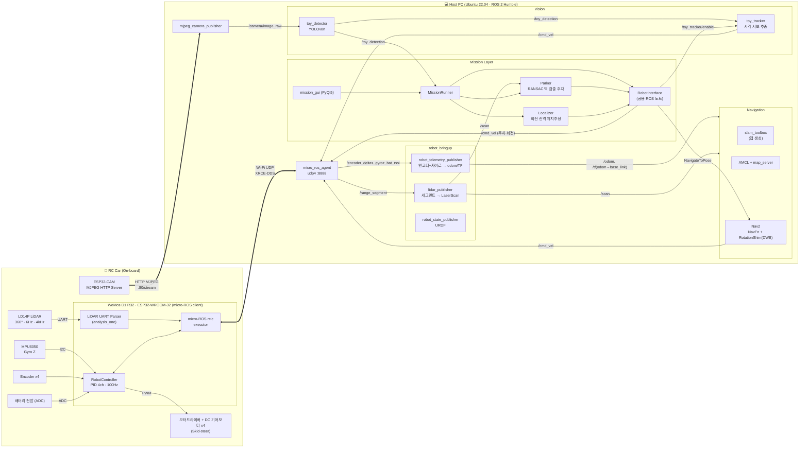
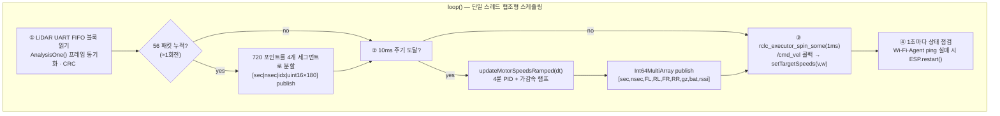
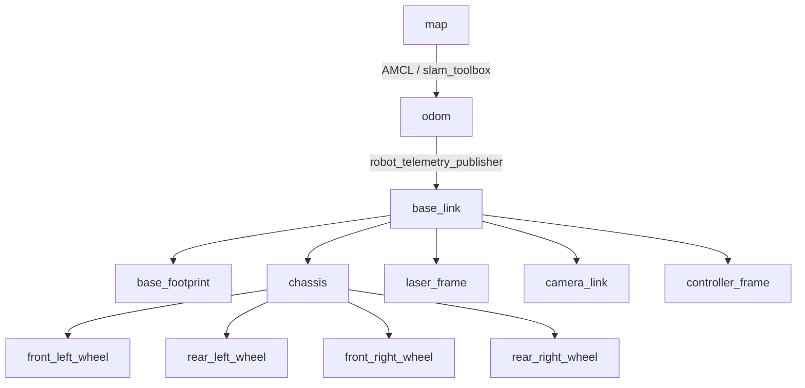
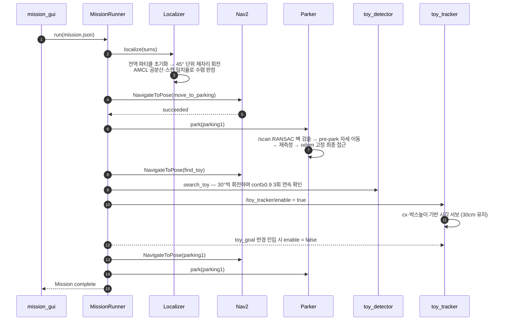
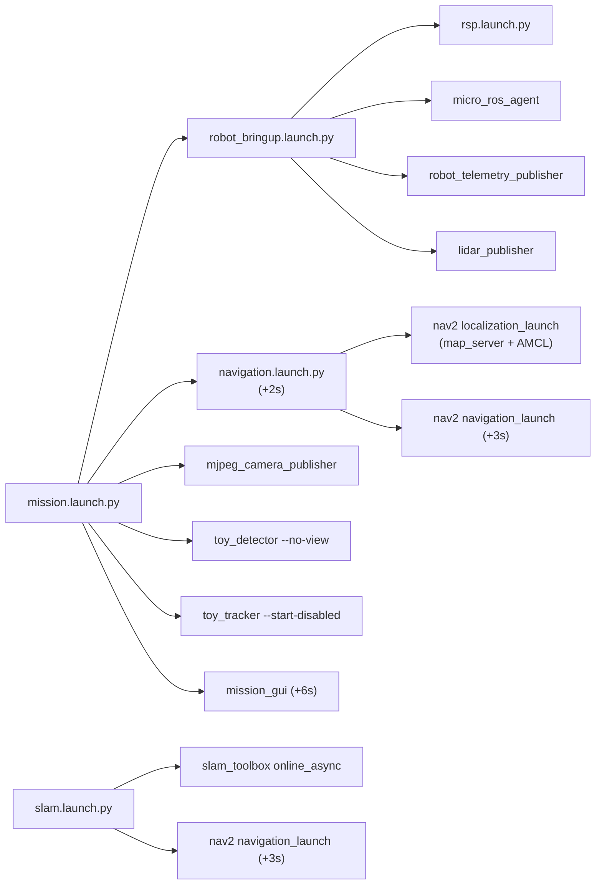

# System Architecture

ESP32 기반 4륜 RC카를 **micro-ROS(Wi-Fi/UDP)** 로 ROS 2 Humble에 연결하고,
PC에서 **SLAM → AMCL/Nav2 자율주행 → 라이다 기반 주차 → YOLOv8 장난감 인식/추종**을
하나의 미션으로 묶어 실행하는 시스템입니다.

---

## 1. 전체 구성도



---

## 2. 계층 구조

| 계층 | 구성 요소 | 역할 |
|---|---|---|
| **Firmware** | WeMos D1 R32 / ESP32-WROOM-32 (`esp32/ros2_rc_car/`) | 모터 PID 제어, 엔코더·IMU 수집, LiDAR UART 파싱, micro-ROS 통신 |
| | ESP32-CAM (`esp32/camera/`) | OV3660 카메라 영상을 MJPEG HTTP 스트림으로 송출 (고정 IP) |
| **Bridge** | `micro_ros_agent`, `mjpeg_camera_publisher` | 마이크로컨트롤러/HTTP 데이터를 ROS 2 토픽으로 변환 |
| **Driver** | `robot_telemetry_publisher`, `lidar_publisher`, `robot_state_publisher` | 원시 데이터를 표준 메시지(`Odometry`, `LaserScan`, `TF`)로 변환 |
| **Navigation** | `slam_toolbox`, `AMCL`, `Nav2` | 지도 작성, 위치 추정, 경로 계획 및 추종 |
| **Perception** | `toy_detector`, `toy_tracker` | YOLOv8 객체 인식, 카메라 기반 시각 서보 |
| **Application** | `mission_gui`, `MissionRunner`, `Parker`, `Localizer` | 미션 편집·실행, 정밀 주차, 전역 위치 추정 |

---

## 3. ESP32 펌웨어



| 모듈 | 파일 | 설명 |
|---|---|---|
| 모터 제어 | `DCMotorPWM`, `DCMotorSpeed`, `PIDController` | 바퀴별 RPM 피드백 PID, PWM 출력 |
| 차량 제어 | `RobotController` | `(v, ω)` → 좌/우 RPM 변환(차동 구동), 4륜 동시 제어, 배터리 측정 |
| 센서 | `Encoder`, `myMPU6050` | 4채널 쿼드러처 엔코더, 자이로 Z축 (캘리브레이션 포함) |
| LiDAR | `analysis_one`, `lidar_frame.h`, `lidar_publish` | LD14P 프레임(0x54 헤더, 12pt/pack) 파싱 및 세그먼트 발행 |
| 통신 | `rosCmdVel`, `rosEncoderDeltasGyroZ` | micro-ROS 노드 / 구독·발행자 초기화 |

**설계 포인트**
- **세그먼트 분할 전송**: micro-ROS XRCE-DDS의 MTU 제한 때문에 1회전(720pt × 2B)을 4개 메시지로 나누어 보내고 PC에서 재조립합니다.
- **NTP 타임스탬프**: 엔코더·LiDAR 데이터에 ESP32 측 실제 측정 시각을 넣어 PC에서 `dt`를 정확하게 계산합니다.
- **자가 복구**: Wi-Fi 끊김이나 Agent 무응답을 감지하면 재부팅해 자동으로 재연결합니다.

---

## 4. ROS 2 토픽 / TF

### 주요 토픽

| Topic | Type | Publisher → Subscriber |
|---|---|---|
| `/cmd_vel` | `geometry_msgs/Twist` | Nav2 · toy_tracker · RobotInterface → ESP32 |
| `/encoder_deltas_gyroz_bat_rssi` | `std_msgs/Int64MultiArray` | ESP32 → robot_telemetry_publisher |
| `/range_segment` | `std_msgs/UInt8MultiArray` | ESP32 → lidar_publisher |
| `/odom` | `nav_msgs/Odometry` | robot_telemetry_publisher → Nav2 |
| `/joint_states` | `sensor_msgs/JointState` | robot_telemetry_publisher → robot_state_publisher |
| `/battery_voltage`, `/rssi_strength` | `Float32`, `Int32` | robot_telemetry_publisher → GUI |
| `/scan` | `sensor_msgs/LaserScan` | lidar_publisher → SLAM · AMCL · Nav2 · Parker |
| `/camera/image_raw`, `/camera/camera_info` | `Image`, `CameraInfo` | mjpeg_camera_publisher → toy_detector |
| `/toy_detection` | `Float32MultiArray` `[found,cx,cy,w,h,conf]` | toy_detector → toy_tracker · MissionRunner |
| `/toy_detection/image` | `sensor_msgs/Image` | toy_detector → mission_gui |
| `/toy_tracker/enable` | `std_msgs/Bool` | RobotInterface → toy_tracker |
| `navigate_to_pose` | `nav2_msgs/action/NavigateToPose` | RobotInterface → Nav2 |

### TF 트리



---

## 5. 미션 실행 흐름

미션은 `maps/<map>_mission.json`에 장소(`places`), 주차 구역(`parking`), 단계 목록(`mission`)으로 저장되고,
GUI에서 편집하거나 `mission_runner`로 GUI 없이 실행할 수 있습니다.



| Step type | 설명 | 사용 모듈 |
|---|---|---|
| `localize` | 제자리 회전으로 AMCL 전역 위치 수렴 | `localization.py` |
| `nav` | 지정 장소/주차 구역으로 이동 | Nav2 `NavigateToPose` |
| `park` | LiDAR 벽 검출 기반 정밀 주차 | `parking.py` |
| `search_toy` | 회전하며 YOLO로 장난감 탐색 | `toy_detector` |
| `follow` | 목표 지점 반경 안에 들어올 때까지 장난감 추종 | `toy_tracker` |
| `final` | Nav2로 주차 구역 근처까지 이동한 뒤 주차 | Nav2 + `parking.py` |

---

## 6. 런치 구성



---

## 7. 네트워크

```
                ┌──────────────── Wi-Fi (Windows 모바일 핫스팟 192.168.137.0/24) ────────────────┐
                │                                                                               │
   D1 R32 (DHCP) ─ UDP :8888 (micro-ROS XRCE-DDS) ──▶  Host PC 192.168.137.1  (micro_ros_agent)  │
   ESP32-CAM 192.168.137.100 ── HTTP :80/stream ────▶  Host PC (mjpeg_camera_publisher)          │
                └───────────────────────────────────────────────────────────────────────────────┘
```
